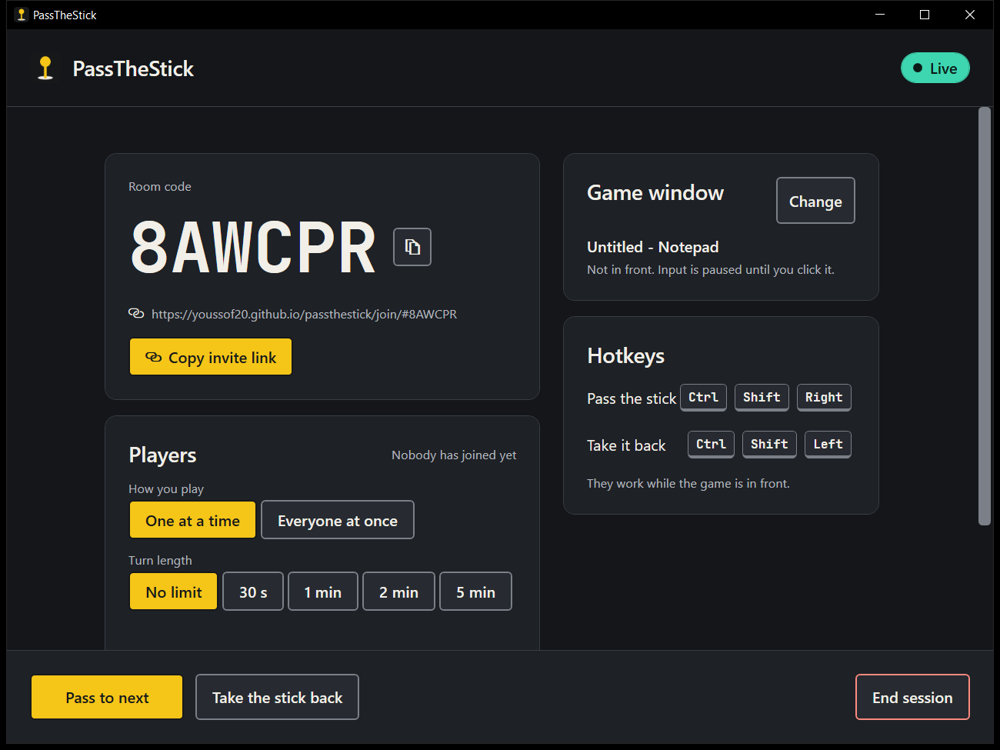
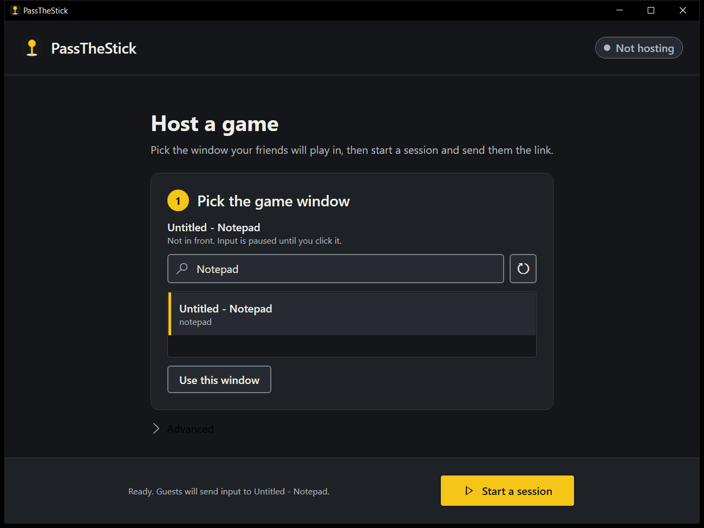

<p align="center">
  
</p>

<h1 align="center">PassTheStick</h1>

<p align="center">
  Let friends play your single-player game over the internet.<br>
  You run the game on your Windows PC. Friends open a link and send their keyboard, controller or phone to it.
</p>

<p align="center">
  <a href="https://github.com/youssof20/passthestick/releases/latest">Download for Windows</a> &middot;
  <a href="https://youssof20.github.io/passthestick/">Website and docs</a> &middot;
  <a href="https://github.com/youssof20/passthestick/issues">Report a problem</a>
</p>

<p align="center">
  
</p>

No account, no video capture, no port forwarding. Everyone watches your Discord screen share. Free and open source (MIT).

## How a session goes

1. Open PassTheStick and pick the game window.
2. Start a session and send the invite link.
3. Friends open the link in a browser. No install.
4. Pass the stick with a hotkey, the tray icon or a button.

<p align="center">
  
</p>

## What it does

- One player at a time holds "the stick" and controls the game. The host passes it with a hotkey (`Ctrl+Shift+Right`), the tray icon or a button, and takes it back with `Ctrl+Shift+Left`.
- A guest can ask for the stick. The host approves with the same key.
- Guests need only a browser. Keyboard, controllers (the browser Gamepad API), on-screen buttons and phone motion all work.
- Phone motion reaches emulators such as Dolphin through a local DSU server, so a phone can act as a Wii Remote.
- Each guest can run a control test first: their buttons light up on the host and on their own screen, and nothing reaches the game.
- Every held key and button is released whenever the stick moves, a player leaves, the game loses focus, or input goes quiet.

It works with any window: emulators, old games, non-Steam games. It is not built for online or competitive games, where virtual input can trip anti-cheat.

## How it is built

| Part | Folder | What it is |
|---|---|---|
| Host app | `host/` | Windows app, .NET 10, WPF. Session logic, input injection, virtual controllers, DSU server, overlay, tray. |
| Web guest | `web/guest` | The page friends open. TypeScript, no framework. |
| Signaling server | `server/worker` | Cloudflare Worker with one Durable Object per room. |
| Website and docs | `site/` | Static pages for GitHub Pages. |
| Design tokens | `design/` | One JSON file generates the app's resources and the site's CSS, and fails the build on any contrast miss. |

Friends connect to your PC directly over WebRTC when their network allows it. The server only introduces the two sides, and carries the stick holder's input if a direct link is impossible. See [docs/ARCHITECTURE.md](docs/ARCHITECTURE.md) and [docs/protocol.md](docs/protocol.md).

## Measured

Numbers from one development machine (Windows 10, loopback), not a benchmark suite.

| What | Result |
|---|---|
| Installer (self-contained, no prerequisites) | 81 MB |
| Portable zip | 74 MB |
| Time from launch to window | 0.86 to 1.4 s |
| Idle CPU (app open, not hosting) | 0.5% of one core |
| Idle memory | 133 MB working set, 71 MB private |
| Data channel round trip, loopback (libdatachannel) | 0.45 ms median |
| Data channel round trip, loopback (SIPSorcery, rejected) | 32 ms median |

Real-world latency depends on the route between host and guest and has not been measured yet.

## Build and test

You need the .NET 10 SDK and Node 22.

```
dotnet test host/PassTheStick.slnx                    # host, protocol, networking, DSU, app
cd server/worker && npm ci && npm test                # signaling server
cd web/guest && npm ci && npm test && node build.mjs  # guest page, bundled into site/join
node scripts/gen-design.mjs                           # regenerate tokens; fails on a contrast miss
```

Run the app against a local server:

```
cd server/worker && npx wrangler dev --port 8787
dotnet run --project host/PassTheStick.App
```

To package a release locally, see `.github/workflows/release.yml`. Installers use [Velopack](https://velopack.io), so installs go to the user profile and updates are delta downloads from GitHub Releases.

## Contributing

Issues and pull requests are welcome. Read [CLAUDE.md](CLAUDE.md) for the code, design and writing rules, and [docs/DECISIONS.md](docs/DECISIONS.md) for why things are the way they are. The pre-rewrite code is kept at the tag `legacy-v0.1.29`.

## License

MIT. Bundled fonts (Familjen Grotesk, Atkinson Hyperlegible Next, JetBrains Mono) are under the SIL Open Font License; their licenses sit next to the files in `site/fonts`.
